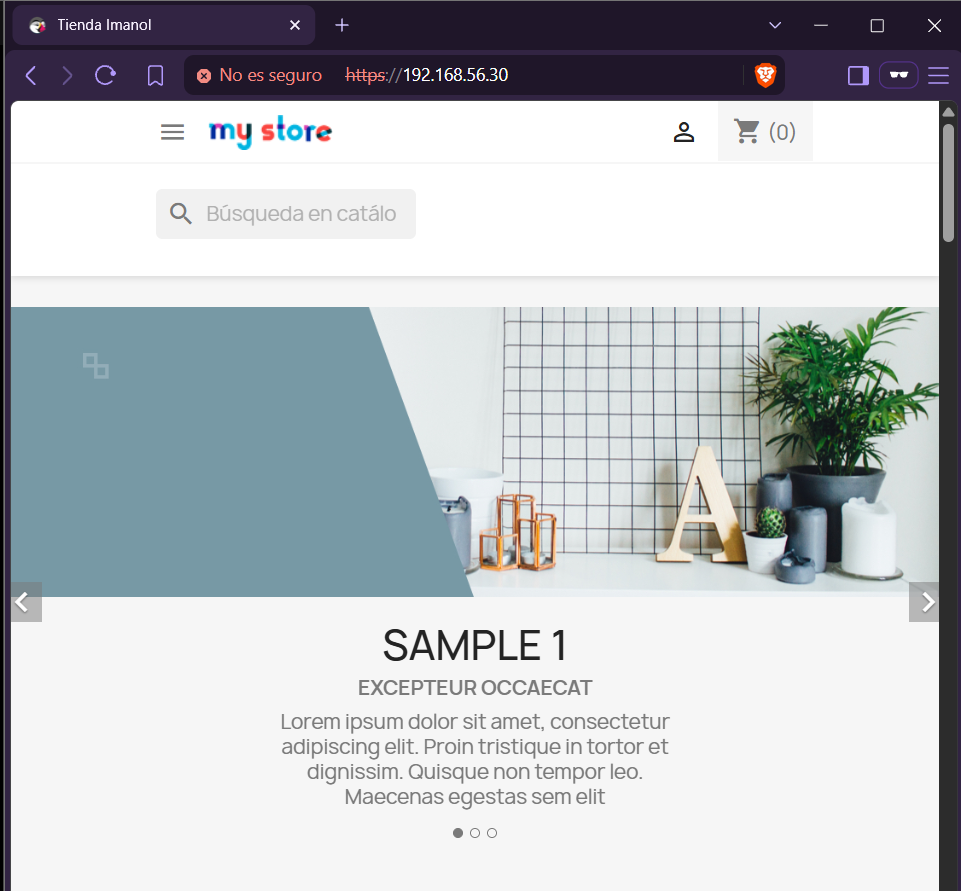
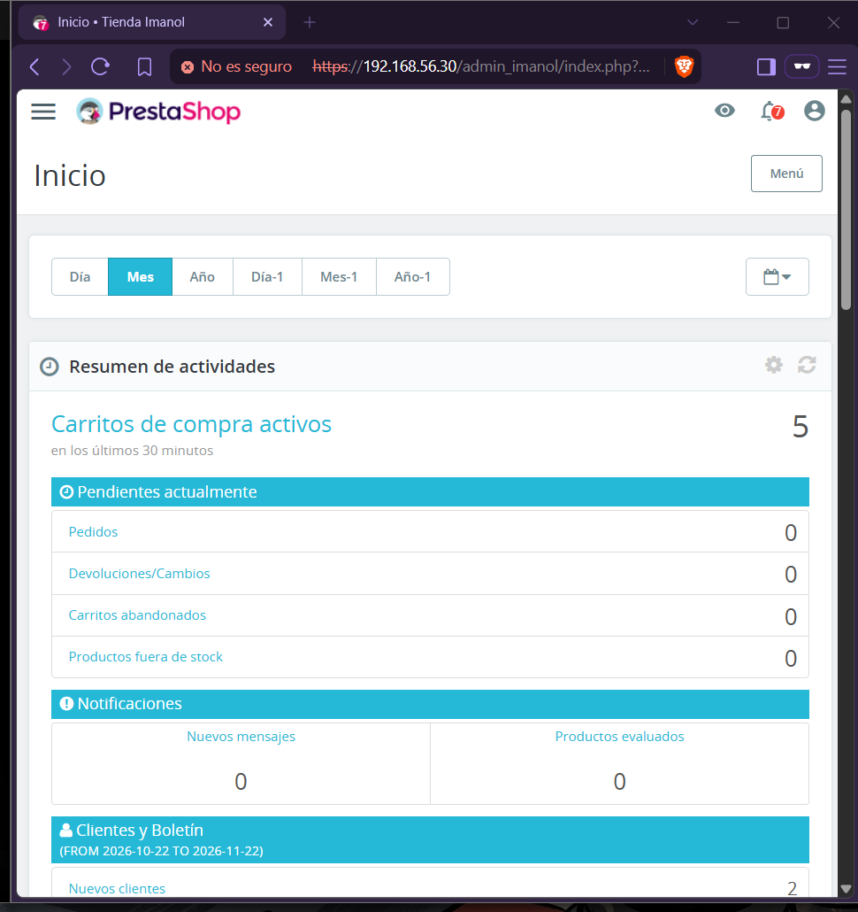

# Implantación de PrestaShop con Vagrant

## 1. Descripción y arquitectura
Despliegue automatizado de la tienda online **PrestaShop** usando **Vagrant** y **VirtualBox** sobre **Debian 12 (`debian/bookworm64`)**:

* **`ImanolSanchezPrestashop` (`192.168.56.30`)**: Máquina virtual con **2 GB de RAM**, pila LAMP (Apache, MariaDB y PHP 8.2 con las extensiones requeridas por PrestaShop), certificado SSL/TLS y despliegue desatendido de PrestaShop mediante CLI[cite: 3, 6].

---

## 2. Explicación del `Vagrantfile`
* `config.vm.box = "debian/bookworm64"`: Define la imagen base de Debian 12.
* `vb.memory = "2048"`: Asigna los 2 GB de memoria RAM mínimos requeridos para la instalación de PrestaShop[cite: 6].
* `ps.vm.network "private_network", ip: "192.168.56.30"`: Configura una IP privada fija para acceder a la tienda desde el navegador del anfitrión y reenvía los puertos `80 -> 8080` y `443 -> 8443`.
* `ps.vm.provision "shell"`: Ejecuta secuencialmente los scripts de aprovisionamiento `install_lamp.sh`, `setup_letsencrypt_https.sh` y `deploy_prestashop.sh`[cite: 7].

---

## 3. Aprovisionamiento y Scripts (`scripts/`)

### `scripts/.env`
Almacena todas las variables de entorno centralizadas: dominio/IP (`192.168.56.30`), credenciales de MariaDB (`prestashop_db`, `prestashop_user`) y parámetros de la tienda y del administrador (`PS_VERSION`, `PS_ADMIN_MAIL`, `PS_FOLDER_ADMIN`)[cite: 7].

### `scripts/install_lamp.sh`
* Instala Apache, MariaDB, PHP y todas las extensiones necesarias para PrestaShop (`curl`, `gd`, `intl`, `mbstring`, `xml`, `zip`, `bcmath`, `imagick`)[cite: 4, 5].
* Ajusta las directivas de `php.ini` (`memory_limit = 256M`, `upload_max_filesize = 128M`, `post_max_size = 128M`, `max_input_vars = 5000`)[cite: 4].
* Copia el archivo de configuración `conf/000-default.conf` con `AllowOverride All` y habilita los módulos `rewrite` y `headers`[cite: 5, 7].

### `scripts/setup_letsencrypt_https.sh`
* Genera el certificado SSL/TLS, habilita el módulo `ssl` y el sitio `default-ssl` en Apache para servir la tienda bajo **HTTPS**.

### `scripts/deploy_prestashop.sh`
* Crea la base de datos `prestashop_db` y el usuario `prestashop_user` en MariaDB.
* Descarga y descomprime el código fuente de PrestaShop en `/var/www/html` asignando permisos al usuario `www-data`[cite: 5, 8].
* Ejecuta la instalación desatendida desde línea de comandos (`php /var/www/html/install/index_cli.php`) con `--ssl=1`[cite: 5].
* Elimina el directorio `/var/www/html/install` y renombra la carpeta de administración a `admin_imanol` por seguridad.

---

## 4. Comprobación del despliegue

### Portada de la tienda (Front Office)
Acceso mediante HTTPS a `https://192.168.56.30`:

### Panel de administración (Back Office)
Acceso mediante HTTPS a `https://192.168.56.30/admin_imanol`:

